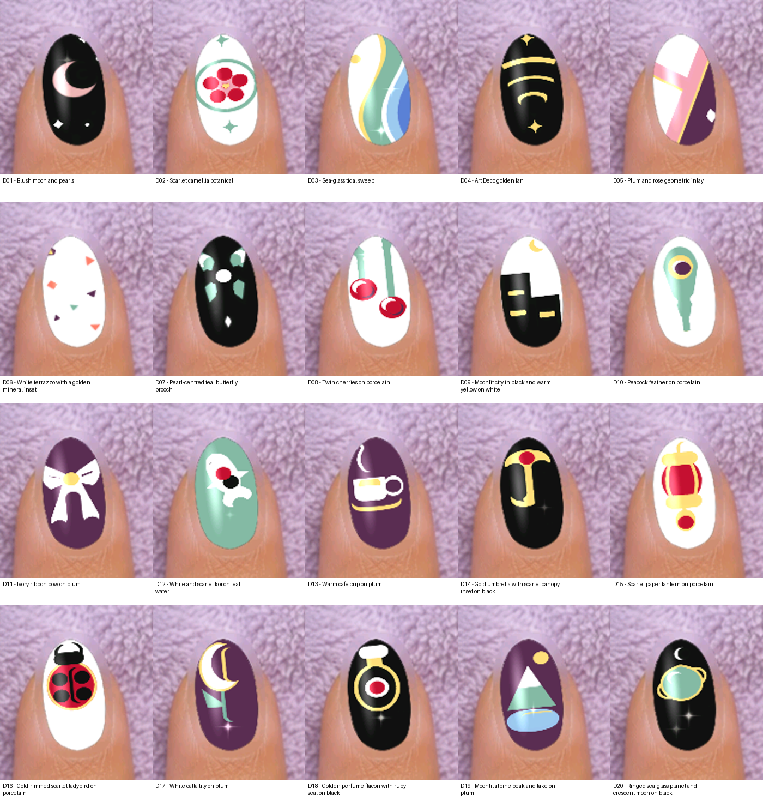
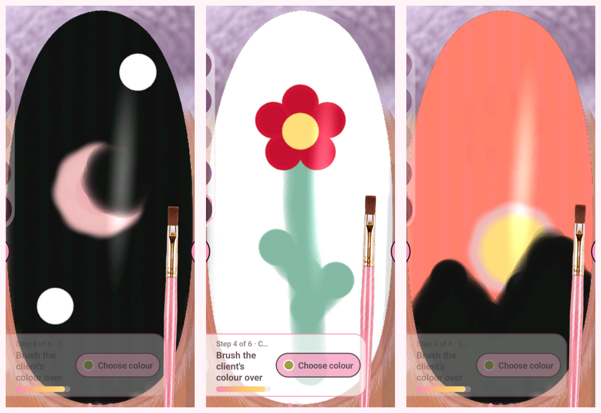

# Nail Reveal AI skill

A portable [Agent Skills](https://agentskills.io/specification) guide to playing
[Nail Reveal](https://play.google.com/store/apps/details?id=com.onteca.nailreveal)
on an Android phone using ADB. It records what Alex and Briar learned while
trying flags, testing the tools and making nail art.

For testing other games or apps, start with the separate
[general playtesting skill](https://github.com/DynamicDevices/game-playtesting-skill/tree/93905be40c2611d903c508cdfd266bd091f1418f).
It contains the shared investigation method, Claude setup, developer reports,
creative proposals and experiment planning. This repository remains the Nail
Reveal-specific companion: tested controls, stage behaviour, timings, recipes
and recorded evidence. See [how the two skills fit together](skills/nail-reveal/references/general-playtesting.md).
The general package is a development candidate, not yet validated live in Claude
or on a second app. Its source revision is pinned here for reproducibility.

The [generative design study](study/README.md) contains20 starting ideas,
100 accepted-change records and the rejected attempts, restorations, recipes,
recordings and comparisons. These are actual game captures, not generated
mock-ups. Counts do not certify beauty: outcomes are uneven and the five
requested full-hand sets are unfinished. See the [final aesthetic audit](study/guide/study-final-aesthetic-audit.md).

This development candidate has completed export validation and sampled gameplay
media review; [review scope and limits](study/REVIEW.md) are recorded. Independent
repository review remains pending. It is not a completed study release.

These were painted sequentially on one test nail, not generated mock-ups.
The crescent was cut through a black coat and partly repainted; the sunset
uses a stripped window filled with yellow. None of these trials was cured.

## Get started

1. Read [Linux and Windows setup](skills/nail-reveal/references/setup.md).
2. Give your AI the [skill entrypoint](skills/nail-reveal/SKILL.md), or add the
   `skills/nail-reveal` directory using your agent's supported skills mechanism.
3. Have the phone's owner authorise access. The agent needs a shell, ADB and a
   way to inspect screenshots; this repository does not give those abilities
   to an AI that lacks them.
4. Start with a single coat, then a simple flag. Record attempts, inspect the
   current stage and map the actual nail before replaying coordinates.

There is no required Node daemon, agent vendor, paid service or privileged input
injector. Ordinary ADB is the baseline. Faster paths are optional and have
[fallbacks](skills/nail-reveal/references/optimisation.md#fallback-ladder).

## What worked

| Tool, top to bottom | Painting-stage result |
| --- | --- |
| E-file/drill | Strips colour and base coat back to pink natural nail |
| Nail file | Did not change the tested fresh polish |
| Cone Bit | Locked in the polish test; later worked in Level2 tidy-base preparation. Polish removal still untested |
| Pink buffer | Did not change the tested fresh polish |
| Polish brush | Paints on held contact; repainting the background can clean an edge |

Holding the brush still can make a dot. In one contact test, requested
0.05-second holds left no visible dot, 0.25 seconds made soft dots and 1 second
made denser dots. These are observed timings, not a guaranteed threshold.
The drill is not a selective top-colour eraser: it removed both applied coats.

## Designs to recreate

| Tests | Instructions |
| --- | --- |
| Single colour and French tricolour | [Original stroke recipe](skills/nail-reveal/references/recipes.md) |
| UK flag | [Layered paths](skills/nail-reveal/references/uk-flag.md) |
| Japan and Brazil | [Circles, recoats and diamond fill](skills/nail-reveal/references/japan-brazil.md) |
| Crescent, flower and sunset | [Coat, cut and repaint recipes](skills/nail-reveal/references/design-lab.md) |
| Contact timing and cleanup | [Tool experiments and measured results](skills/nail-reveal/references/paint-and-tools.md) |

See the [test record](tests/README.md), [images and video index](media/README.md),
and [contact measurements](tests/contact-results.csv). Failures and limitations
are included: translucent recoats, incomplete rims, soft edges, locked tools,
recording interruptions and unsupported multitouch.

## Tested scope

Live tests used Nail Reveal 1.25, Android 15 and a 1080×2400 phone, controlled
from Linux. Windows setup is documented but has not been tested live.
Coordinates, tool offsets and palette timings are layout-specific.
Multitouch, adjustable brush width and Cone Bit polish removal remain unverified.
The later study recorded explicit Lamp/top-coat completion, but saved-manicure
persistence and all-five-nail editing remain unproved. This is an experimental
usage skill, not an official game manual.

## Rights and privacy

[MIT](LICENSE) covers our original instructions and code. Nail Reveal, its
interface and game assets remain the property of their respective owners;
the MIT licence does not relicense those assets. Captures are included to
document gameplay tests. This is an independent project, not an endorsement
by the game's creators.

Public videos are cropped, silent, resized copies with source metadata removed.
Private originals, unrelated photographs, device/account identifiers and
authorisation files are not included. Publishing your own recordings requires
the owner's permission and a privacy check.

Assisted-by: Briar.
