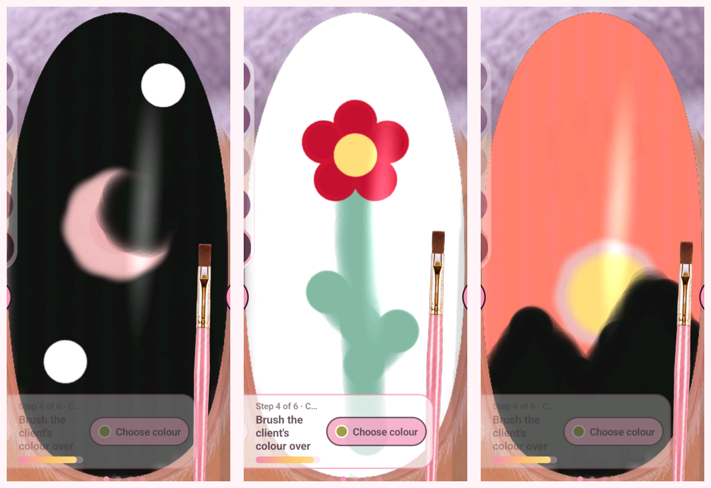

# Gameplay images and recordings

These captures document the tested recipes. Public MP4 copies preserve the
recorded duration but crop the original 1080×2400 frame to an 800×1700 nail
viewport at (140,400), resize it to 400×850 and use 12 fps. They are silent and
have source metadata/extra streams removed. This keeps the files suitable for
GitHub; private full-size originals were retained. Some controls/hints lie
outside the public video crop: use the written recipes for input locations.
Do not use a 12 fps copy to infer sub-frame contact timings.
The [manifest](manifest.json) records durations, public-file hashes, sizes and
the single video stream in each exported file.

## Videos

| Recording | What it covers |
| --- | --- |
| [01 — selection, colour and first flag](videos/01-selection-colour-flag.mp4) | Initial navigation, paint and stripe attempts |
| [02 — continued flag tests](videos/02-continued-flag.mp4) | Further coverage and tricolour work; four cleanup strokes between recordings were missed |
| [03 — left tool icons](videos/03-left-tool-icons.mp4) | Early tool investigation; despite the original working name, no UK flag was painted in this recording |
| [04 — blue-base optimisation](videos/04-blue-base-optimisation.mp4) | Swipe versus continuous-contact experiments |
| [05 — UK flag layers](videos/05-uk-flag.mp4) | White underlay, red diagonals and cross |
| [06 — Japan and Brazil](videos/06-japan-brazil.mp4) | Opaque recoats, circles, diamond fill/outline and broad band |
| [07 — contact and tools](videos/07-contact-and-tools.mp4) | Point matrix, buffer, file and drill tests; recorder later exited across an interruption |
| [08 — cleanup controls](videos/08-cleanup-controls.mp4) | Fresh recorder, white-background edge cleanup and short drill contacts |
| [09 — crescent, flower and sunset](videos/09-crescent-flower-sunset.mp4) | Three sequential design trials, including stripping and repainting |

## Final images

- [Crescent](images/nail-art-crescent.png), [flower](images/nail-art-flower.png), [sunset](images/nail-art-sunset.png)
- [UK flag](images/uk-flag-first-attempt.png), [Japan](images/japan-flag-first-attempt.png), [Brazil](images/brazil-flag-first-attempt.png)
- [Point-test grid](images/point-test-grid.png)
- [Brush cleanup before/after](images/brush-cleanup-before-after.png)
- [Original French-flag capture](images/steps/nail-lab-flag-final.webp)

Intermediate game screenshots, contact close-ups and early tool captures are
in [images/steps](images/steps/). Derived nail-view previews are resized copies;
they are not physical touch-coordinate frames. The full-size source captures
were not replaced by these public copies.

## Rights

Nail Reveal and its interface/assets retain their owners' rights. These media
document gameplay tests; the repository's MIT licence does not relicense the
game assets. Original unrelated photographs, account/device identifiers and
authorisation files are excluded. No creator endorsement is implied.
