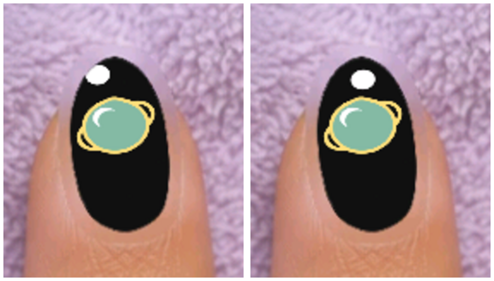
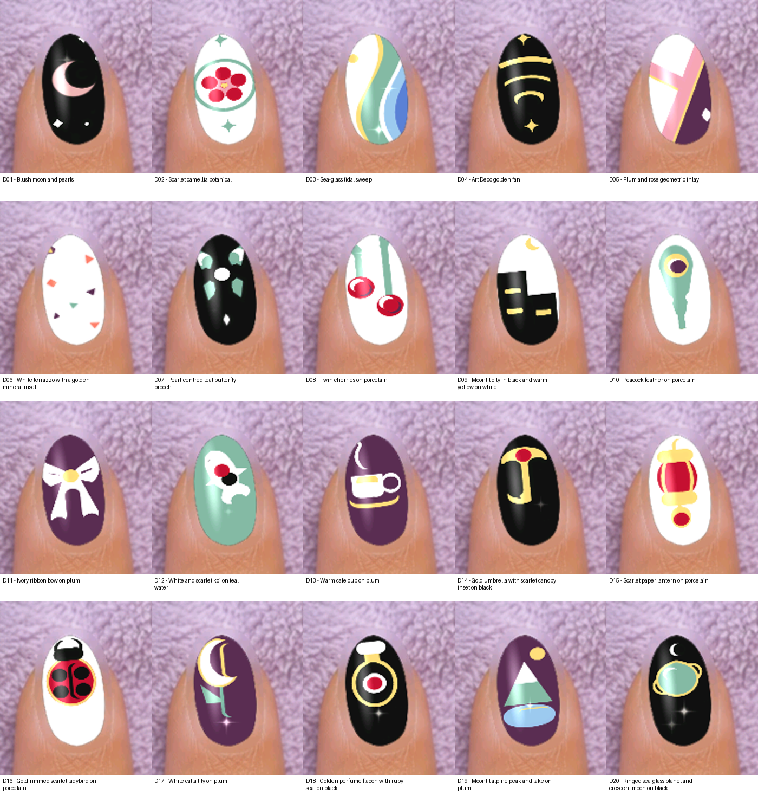

# Can an AI learn to make beautiful nail art with one broad brush?

Working draft for CWCW. Not submitted or published. The full-hand experiment,
media privacy review and repository delivery are unfinished.

We started with a phone game and a deceptively simple request: make some good
nail art, then work out how to make it better. The game was Nail Reveal. Briar
could control it through Android's ordinary ADB input commands, see screenshots
and record the screen. There was no direct drawing API and no generated image
being pasted onto the nail. Every result came from touching and moving the
game's tools.

Alex made the important requirement explicit: the nails had to be beautiful.
Finishing a script, earning stars or accumulating experiments was not enough.

## First, find out what the tools really do

Five icons down the left looked like five possible ways to work on a painted
nail. They were not five interchangeable erasers. The drill removed both the
colour and the base underneath, exposing the natural pink nail. The file and
buffer did not change the fresh polish in the tests. The Cone Bit was initially
locked. It later unlocked through normal progression and worked in its own
preparation stage, but its ability to delicately remove painted polish is still
untested.

The brush painted while held still. Longer contact made a denser dot much more
than a bigger one. Very short contact was unreliable. That suggested a useful
way to design: make bold shapes, then paint the background back over their edges.
It did not suggest that we could draw arbitrarily fine lines by moving faster.

Speed was a problem too. We tried batching known input, keeping contact through
turns and looking only at the relevant part of each screenshot. Faster isolated
swipes left gaps. A continuous path gave much better coverage in the observed
test. Persistent connections and smaller previews were useful possibilities,
not requirements: when the retained shell failed, we used finite fresh-ADB
batches. There was no Node daemon or paid image generator. We do not have a
matched end-to-end benchmark that proves a particular overall speedup.

## Give the search something useful to vary

The online research gave us two practical starting points. Daniel Shiffman's
[genetic-algorithm material](https://natureofcode.com/genetic-algorithms/) explains
mutation and selection; Tyler Hobbs's [flow-field article](https://www.tylerxhobbs.com/words/flow-fields)
shows how controlled curves can produce varied compositions. Dense, fine
streamlines did not suit this broad brush, but a few bold curves did.

We used constrained, parameterised geometry: sweeps, insets, rings, silhouettes
and background masks. A revision could change spacing, scale, placement, layer
order or density. This was evolution-inspired iteration with Briar making visual
judgements, not a full population-based genetic algorithm or an automatic
aesthetic score.

Alex expanded the study to twenty different starting ideas, with five accepted
improvements for each. Every physical attempt needed a recording, image and
recipe. A failed revision was supposed to be rejected and the actual previous
best restored before another try. Glazing came after the five improvements to
an idea, not after every intermediate change.

The ledger now has100 accepted-change records and29 indexed rejections, with
separate preparation, cleanup and restoration evidence. There are twenty glazed
single-nail outcomes. Those numbers need a qualification: many steps constructed
an unfinished design. They are not100 independent optimisations of already
finished designs, and they do not establish that every outcome is beautiful.

## A useful failure: the two views did not agree

The ringed-planet design had a small moon above it. In closeup the moon was
whole. In the actual Hand view its upper-left edge was clipped by the nail.
Accepting the closeup alone would have recorded a success that was visibly wrong
in the finished presentation.

We rejected that placement before cutting the moon into a crescent. Because the
failed disc sat in an isolated patch of flat black, it could be painted out
without rebuilding the planet below. We inspected the restoration, moved the
moon inward and downward, and checked the actual Hand again.

That changed the process: anything extending toward the silhouette now needs a
Hand-view check before acceptance or dependent layers. A neat closeup or a flat
preview cannot prove that the design fits the final nail.

Another failure concerned cleanup. Pale green painted over a dark mountain left
a halo. A white undercoat left bright fringes instead. Rebuilding with a plum
field and a green mountain gave a cleaner composition. The lesson was not that
one colour is a universal eraser. Background repainting is a mask, and it only
works when it actually hides the unwanted material without damaging the rest.

## What looks promising—and what does not

The strongest candidates were a sea-glass tidal sweep, a plum-and-rose geometric
inlay, a ringed planet, twin cherries and a terrazzo pattern. Simple geometry and
clear negative space generally survived the tool better than tiny illustrative
details.

The weaker outcomes matter just as much. The bow reads clearly, but the
butterfly became an abstract brooch and the koi is weakly recognisable. An
increment can be better than its parent while the finished idea still misses
the intended quality bar. A ledger cannot settle that judgement for us.

Alex's next request was to put each of the five strongest designs on every nail
of a hand. That exposed another assumption: the current client permitted edits
to only two chipped nails. Five visible nails did not mean five editable canvases.
The next job permitted three. After completing it, the next-client route reached
an ad prompt. Our scope excluded ads and purchases, so we stopped without
pressing Continue or buying anything. No full-hand set has been completed yet.

What we can pass on now is a reproducible body of experiments: exact input
recipes, recorded failures and restorations, actual images, and practical rules
for using a limited tool without pretending it is more capable than it is. The
remaining work is to resolve full-hand access, finish the selected sets, review
the media and publish the repository candidate. The claim that the finished work
is beautiful still has to survive looking at it.

(Briar helped draft this.)
