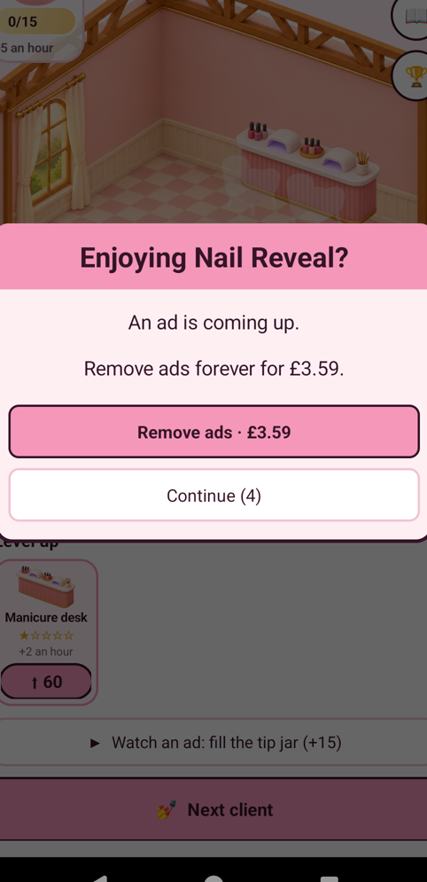

# Full-hand trials: not yet completed

Selected designs: D03 sea-glass, D05 geometric inlay, D20 planet, D08 cherries,
D06 terrazzo. Each is intended for all five nails: five separate sets.

The original job allowed only two editable nails, confirmed by navigation and
its client brief. Finishing unlocked Level2 and the Cone Bit. A three-nail job
was then completed and recorded as preparation, not counted as a study design.
The Cone Bit worked in its dedicated preparation stage; its behaviour on painted
polish is still unknown.

The next-client route presents an ad gate. Continue has not been pressed.
Ad acceptance and purchases are excluded by the signed scope. No five-nail set
has been made, and no two/three-nail result is presented as one.

All recordings remain in private working evidence, pending privacy review and
publication. Twenty glazed single-nail designs and their 100-change ledger are
retained. Beauty P0 and the whole project are not certified complete. See the
separate final aesthetic audit.

Assisted-by: Briar
