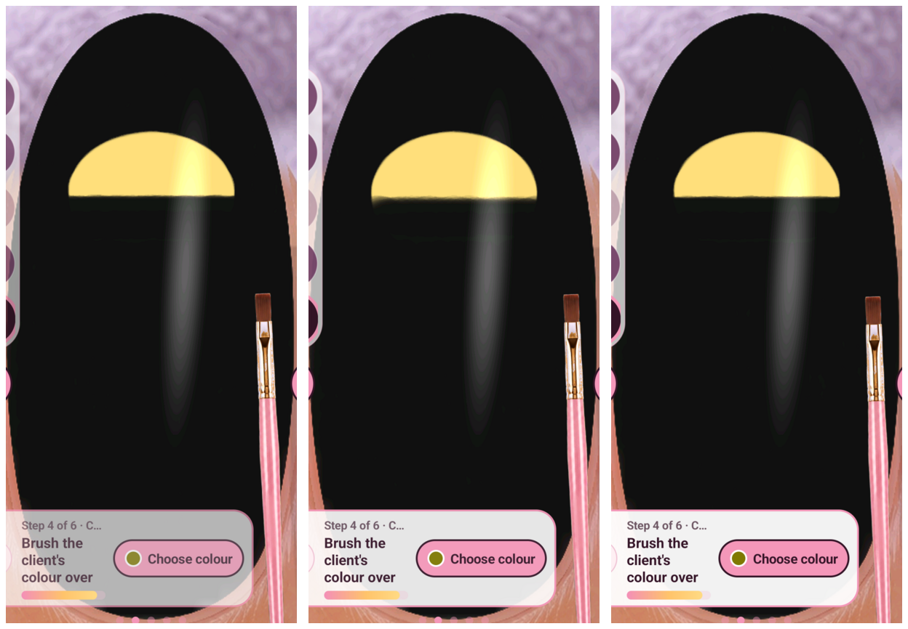

# Straight-mask speed comparison

Left to right: dense-path reference; rejected1200ms native swipes; usable3600ms
native swipes. Each started from an actually recreated, inspected gold oval on
black. Same four600px horizontal rows and colour. All attempts recorded; this
test adds no accepted design cycles.

| Method | Stage elapsed | Result |
| --- | ---: | --- |
| Dense10px samples,0.4s endpoint dwells |23.533s|Clean reference edge |
| Native1200ms per row |8.582s|Rejected:uneven edge/fringe |
| Native3600ms per row |18.122s|Comparable clean edge; optional |

The usable candidate takes5.411s less—23.0% lower elapsed for this stage. Times
include palette selection, paint, capture, transfer and crop,not model analysis
or fixture recreation. One trial each,not a general speed guarantee.

Gold contour sampled x350..730 every10px:reference lower y921..924,mean922.33;
native3600 y924..926,mean924.79. The native edge is about2.5 physical pixels
lower,not identical. Its contour span is2px versus3px reference. The1200ms edge
has6px span and mean928.59. Thresholded gold:R>150,G>100,R−B>40,in y700..979.

No warm-colour residue above R−B>5,G−B>3 in discarded ROI350980,size350×130
for any candidate. This narrow check alone does not establish visual quality;
the1200ms failure is at the edge above that ROI. Native3600's mean absolute RGB
difference in ROI350950,size350×120 is0.08,max5,relative to reference. Small
green-channel/render differences remain; no claim of pixel-perfect equivalence.

Keep native3600 optional for comparable straight horizontal masks on the tested
phone/layout. Dense paths remain the fallback and preserve inherited precise
edge positions. Other orientations,colours,devices and continuous curved fills
still require testing. A failed speedup must never prevent ordinary operation.
Inspect partial effects before fallback; never blindly repeat a completed batch.

Original source:work/generative-study/attempts/swipe-*. Each has stages.json,
recipe.json,creation.mp4,execution.json and full/mapped image captures. Local
compilation/safety checks:test_native_swipe.py,three tests passed. No Node,
daemon,new dependency,root or security change. Repository publication pending.

Assisted-by: Briar
