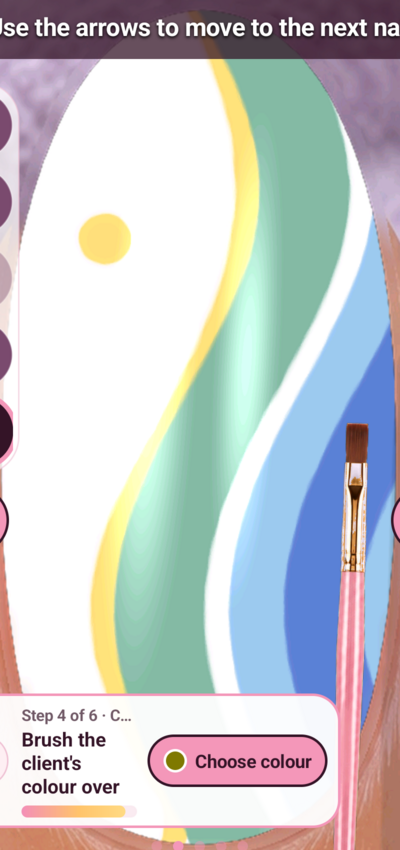

# Sea-glass tidal sweep — D03

Five accepted improvements, followed by a recorded Lamp transition and final
closeup. This is 15/100 accepted cycles across three ideas, not study completion.

## Recreate on the tested layout

Nail Reveal1.25, Android15, NothingA063,1080×2400, tall second nail. Coordinates
are physical screen coordinates; colour swatches and tool positions are layout
specific. Use the explicitly authorised device. Record before input. Do not
purchase, watch ads, submit Done or infer gallery persistence.

Recipes are retained in `work/generative-study/attempts/`. Run each prewritten
attempt once with `python3 -B work/generative-study/record_attempt.py ID` after
establishing live authority and game state. The runner refuses existing video
evidence, records before painting, releases contact, retains full PNG plus mapped
crop and checks the finished MP4 duration. Replay copies need fresh attempt IDs;
never overwrite original evidence.

| Order | Attempt | What it creates |
| --- | --- | --- |
| Preparation | d03-clean-base | Drill strip, brush, opaque white coat-v2; inspect all edges |
| Baseline | d03-baseline | Aqua side panel, boundary x=590+145sin(2πt),y=480+1690t |
| Improvement1 | d03-c01-a02 | Blue outer region at boundary+200; dense26/35/43 interval fills |
| Improvement2 | d03-c02-a01 | White path offset180, blue230: narrow surf ribbon |
| Improvement3 | d03-c03-a01 | Yellow-150, white-200, aqua0: fine warm leading coast |
| Improvement4 | d03-c04-a01 | Yellow at350,1000, reduced by white radius130 annular mask |
| Improvement5 | d03-c05-a02 | Deeper blue at boundary+340, clamped1040; three96-segment passes |
| Finish | d03-glaze | Lamp690,2200 and wait3s; capture hand view |
| Final image | d03-glazed-closeup | Hand380,2200 and wait3s; retain closeup |

Use the exact `stages.json` files, not this summary, for stroke ordering and
dwells. Swatches: aqua250,1410; light blue395,1410; deeper blue540,1410;
white390,1560; yellow685,1265. Palette open230,2200, close540,1740; tested
settling delay0.7s. Hold/paint occurs about120px above contact on this layout.

All attempts include recipes, execution timings, silent screen recordings,
original frames and nail crops. Crop origin140,400, size800×1700 resized400×850:
physical x=140+2u,y=400+2v. Whole-hand captures use a different composition;
their normal painting crop does not isolate the actual nail.

## Rejected attempts and restorations

- d03-c01-a01: blue fill retained visible horizontal scallops. Rejected and
  physically restored through d03-restore-baseline-after-c01 before denser retry.
- d03-c05-a01: smooth but too slight to count at nail scale. Rejected and restored
  through d03-restore-c04-after-c05 before widening the current.
- d03-c05-edge-review: matching-white contact did not move the idle brush.
  d03-c05-hand-review provided unobscured composition at lower detail instead.

The final deeper-blue shape is a ribbon with light blue also beyond it, not a
fully filled outer panel. No claim of photorealism, guaranteed beauty, gallery
persistence or publication. Images show the actual app result.

Assisted-by: Briar
