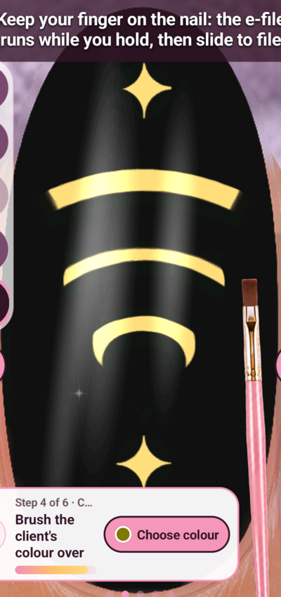

# Stepped Deco fan — D04

Five accepted refinements, one rejected radial-cut experiment, recorded
restoration, required cleanup and post-five-cycle glaze. Study total20/100.

Tested layout only: NothingA063, Android15, Nail Reveal1.25,1080×2400, tall
second nail. Use explicit authorised serial, current game state and live scope.
Recipes and silent original recordings live in work/generative-study/attempts/.
Each stages.json contains exact ordered touches, paths, delays and palette taps.
Use record_attempt.py with a fresh attempt ID; never overwrite source evidence.

## Exact recreation order

1. d04-clean-base: full drill strip, brush and opaque black coat-v2. Inspect tip,
   sidewalls and lower edge before further painting.
2. d04-c01-a01: rebuild black and smaller warm fan, apex550,1650, radius560,
   angles-115°..-65°, with straight side masks.
3. d04-c01-edge-cleanup: four inward black passes per side remove remaining
   fringe. This is required finishing of improvement1, not another cycle.
4. d04-c02-a02: black inner fan radius460, angles-112°..-68°, leaves curved rim.
5. d04-c03-a01: smaller warm arcs360/160 and black inner fills280/100 give
   two nested bands below it. These are actual stepped curves, not fine ribs.
6. d04-c04-a01: warm contacts550,780 and550,1850; black corner masks±80 leave
   tapered accents. Lower masks approach vertically from below, avoiding the
   Choose colour button and unwanted cuts across the accent.
7. d04-c05-a01: black arcs at radii500/300, three96-segment passes each.
8. d04-glaze: Lamp690,2200, wait3s; preserve whole-hand frame.
9. d04-glazed-closeup: Hand380,2200, wait3s; retain finished closeup.

The baseline d04-baseline is retained as evidence but not replayed before this
chain: c01 includes its own black reset. Swatches: black830,1560;
warm yellow685,1265. Palette open230,2200, close540,1740;0.7s settling delays.
Brush contact marks appear roughly120px above touch on this layout.

## Failure and limitations

d04-c02-a01's radial strokes made rounded bites, not delicate ribs. Do not use
it in the accepted chain. d04-restore-c01-after-c02 records actual restoration
before the accepted broad inner opening was attempted.

The final lower band remains a stronger crescent; line weights are not equal.
Warm polish is not demonstrated metallic gold. No Done submission, gallery
persistence test or complete five-nail hand has yet been performed for this idea.

Original full frames are retained alongside crop origin140,400, size800×1700,
resized400×850. Preview coordinates map to physical x=140+2u,y=400+2v.
The whole-hand preview is not isolated by that painting crop. Whole-hand final
presentation requires every nail decorated, not this one accent nail.

Assisted-by: Briar
