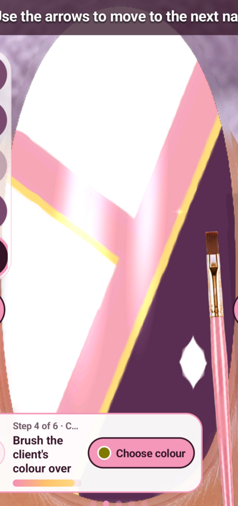

# Plum and rose geometric inlay — D05

Five accepted refinements, two rejected attempts with recorded restorations,
required full-field cleanup and glaze. Study total25/100 across five ideas.

Tested only on NothingA063/Android15/Nail Reveal1.25 at1080×2400, tall second
nail. Use explicit authorised serial and live scope. Exact ordered recipes,
timings, original silent recordings and full screenshots are retained under
work/generative-study/attempts/. Each stages.json is the reproduction source;
this summary does not replace it. Use fresh attempt IDs with record_attempt.py
to avoid overwriting any original evidence.

## Recreation order

1. d05-clean-base: drill strip; brush; two opaque plum coat-v2 passes. Inspect
   whole nail for old black/gold traces.
2. d05-baseline: white left plane, contact edge x=1100-0.4y,y480..2170;
   fill to x200 with30/40 intervals, then repeat straight boundary.
3. d05-c01-a01: three pink passes at edge+80 make the inlay band.
4. d05-c02-a01: warm edge+220, plum+250, three passes each leave a fine seam.
5. d05-c03-a01: pink cross180,1050→980,1650; restore main seam.
6. d05-c03-cleanup: mandatory full plum repaint, not only boundary restoration.
   Three offset row fills26/35/43 and boundary passes remove far-side pink stub.
7. d05-c04-a02: warm lower cross edge at y=0.75x+1085, white cut+30y;
   start safely at x220, backtrack to100, then traverse to980. Restore main pink,
   warm seam and whole plum region. Do not substitute the hooked a01 recipe.
8. d05-c05-a02: ivory short held path centred790,1750; four straight plum masks
   with normal offset85 form smaller kite, intended half-width40/half-height75.
9. d05-glaze: Lamp690,2200, wait3s and capture whole hand.
10. d05-glazed-closeup: Hand380,2200, wait3s and retain final closeup.

Swatches: plum250,1560; white390,1560; pink540,1115; yellow685,1265.
Palette open230,2200 and close540,1740 with0.7s settling delays. Physical
paint/contact offset is about120px upward on this layout. Yellow is not
demonstrated metallic gold; kite facets have slightly softened edges.

## Failures retained

- d05-c03-a01 initially left a pink stub in the far plum field. Its accepted
  final is d05-c03-cleanup/final-nail.png; cleanup is not another counted cycle.
- d05-c04-a01 produced a round entry hook. Rejected; actual restoration is
  d05-restore-c03-after-c04 before corrected a02.
- d05-c05-a01 crowded the sidewall. Recorded hand review exposed the issue;
  d05-restore-c04-after-c05 restored the plum before smaller inward a02.

Crop mapping: full1080×2400, origin140,400, size800×1700 resized400×850;
physical x=140+2u,y=400+2v. Full hand has a different composition; the ordinary
painting crop does not isolate the actual small nail in that view. Keep full
frames. No Done/gallery persistence or all-five-nail set was tested here.

Assisted-by: Briar
